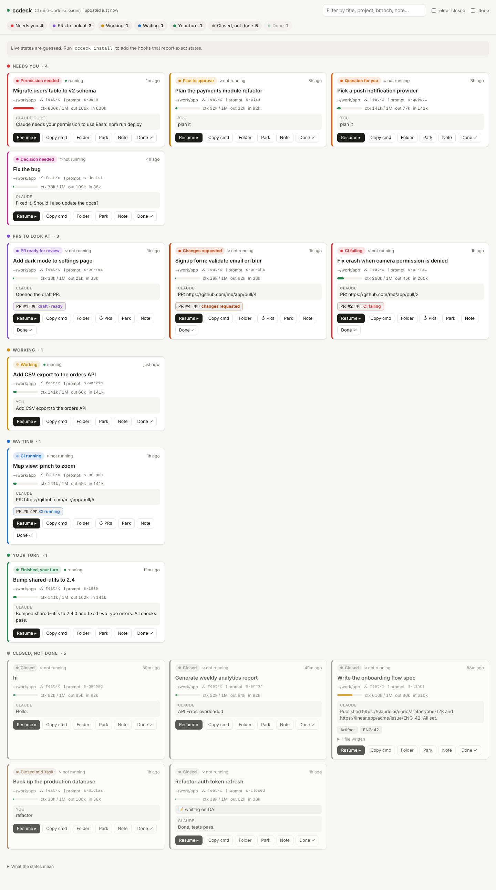

# ccdeck

Keep track of your **local Claude Code sessions** on Ubuntu/Linux. It answers four questions:

- Which sessions are open?
- Which ones need you, and for what?
- Which ones produced a PR, an artifact or a document?
- Which ones are done?

You get a live dashboard in the browser at `http://localhost:7799`, served by a small background service. There is also a terminal list. Desktop notifications tell you when a session starts waiting on you.



`ccdeck` is one Python 3 file plus one HTML page, using only the standard library. It reads the transcripts Claude Code already writes to `~/.claude/projects/` and never modifies them. PR states come from the GitHub CLI (`gh`) when it's installed.

## Install

### As a Claude Code plugin (recommended)

In Claude Code:

```text
/plugin install ccdeck --marketplace slonik923/ccdeck
```

On Claude Code older than 2.1.275, run `/plugin marketplace add slonik923/ccdeck` first, then `/plugin install ccdeck@ccdeck`. Restart Claude Code or run `/reload-plugins`.

That's all. When a session starts, the plugin's hooks:
- record each session's live state (working, waiting for permission, finished, closed);
- start the dashboard in the background if it isn't already running.

Open it at `http://localhost:7799`, or with `/ccdeck:dashboard`.

For PR states, also run `sudo apt install gh` and then `gh auth login`.

The plugin adds these commands to Claude Code:

| Command | What it does |
|---|---|
| `/ccdeck:dashboard` | Prints the dashboard's address and opens it in your browser |
| `/ccdeck:done [note]` | Marks the current session done, with an optional note |
| `/ccdeck:park [note]` | Sets the current session aside for later |

### From a clone (always-on service, `ccdeck` command)

To get the `ccdeck` terminal command, have the dashboard running from login even before you open Claude Code, and get an app launcher entry:

```bash
git clone https://github.com/slonik923/ccdeck.git ~/ccdeck
~/ccdeck/ccdeck install            # add --no-hooks if you also use the plugin
```

`install` does four things:

1. **Command.** It links `~/.local/bin/ccdeck` to the script in the clone, so `git pull` updates it.
2. **Hooks.** It adds the same hooks to `~/.claude/settings.json`, after saving a backup as `settings.json.bak-ccdeck`. Skip this with `--no-hooks` when you use the plugin. Having both is harmless: a duplicate event is ignored.
3. **Background service.** It adds a systemd user service, `ccdeck.service`. The service starts at login, restarts if it crashes, keeps PR states up to date and sends the notifications.
4. **App launcher.** It adds a **ccdeck** entry that opens the dashboard.

Options: `--port 8123`, `--no-hooks`, `--no-service`. To remove everything: `ccdeck uninstall`. Your marks and notes stay in `~/.claude/ccdeck/`.

## The dashboard

Sessions are grouped by what they need from you. The dashboard refreshes every 2 seconds. The browser tab title and icon show how many sessions need you.

| Group | State | Meaning |
|---|---|---|
| 🔴 **Needs you** | Permission needed | A tool call is waiting for your approval |
| | Question for you | Claude asked a multiple-choice question (`AskUserQuestion`) |
| | Plan to approve | Claude wrote a plan and waits for approval (`ExitPlanMode`) |
| | Decision needed | Claude's last message ends with a question or asks you to choose |
| | Error | The last turn ended with an API error |
| 🟣 **PRs to look at** | CI failing | A PR from the session has failing checks |
| | Changes requested | A reviewer asked for changes |
| | PR has conflicts | The PR can't merge cleanly |
| | PR ready for review | The PR is open and its checks are green (or it has none). Review it or merge it |
| 🟡 **Working** | Working | Claude is running right now |
| 🔵 **Waiting** | CI running | The PR's checks are still running |
| | Parked | You set the session aside |
| 🟢 **Your turn** | Finished, your turn | Claude finished, and the session is open and waiting for your next prompt |
| | Quiet, interrupted? | The last state was "working", but nothing has happened for 15 minutes |
| ⚪ **Closed, not done** | Closed / Closed mid-task | The process has exited and you haven't marked the session done |
| ✅ **Done** | PR merged | All of the session's PRs are merged |
| | Done | You marked it done (hidden by default) |

Each card shows:
- the title, folder, branch and number of prompts
- **token usage**: a bar showing how full the context window is, plus output and input tokens. Subagents are included, and hovering shows the breakdown, including cache reads
- the last message: Claude's reply, the permission request, or your own prompt (click it to expand)
- PRs with their live state
- links to artifacts, Notion, Linear, Figma and Google Docs
- the files the session wrote

Each card has these buttons:
- **Resume ▸** opens a new terminal window in the session's folder and runs `claude --resume <id>`.
- **Copy cmd** copies that same command.
- **Folder** opens the session's folder in the file manager.
- **↻ PRs** re-checks the PR states now.
- **Park**, **Note** and **Done ✓** set your own marks on the session.

Keyboard: `/` jumps to the filter box and `Esc` clears it.

The terminal used for **Resume ▸** is the first one found from GNOME Terminal, Ptyxis, Console, Konsole, xfce4-terminal, Tilix, kitty, Alacritty and xterm. To choose a different one, set `CCDECK_TERMINAL`, for example `CCDECK_TERMINAL="wezterm start --"`.

## Terminal

```text
ccdeck                 sessions grouped by state (done ones and closed ones older than 14 days are hidden)
ccdeck -a              everything
ccdeck show 3          details: PRs with state, links, files, last messages
ccdeck resume 3        cd into the folder and claude --resume
ccdeck done 3 [note]   mark solved             ccdeck undone 3
ccdeck park 3          set aside               ccdeck unpark 3
ccdeck note 3 text     attach a note
ccdeck open            open the dashboard
ccdeck serve           run the dashboard in the foreground (instead of the service)
```

`3` is the row number from the last list. A prefix of the session id also works.

## How it works

- **Transcripts.** `~/.claude/projects/*/*.jsonl` provides each session's title, folder, branch and messages, plus the PR, artifact and document links Claude posted or created, and the files it wrote. Parsing is cached by file size and modification time.
- **Hooks.** The hooks (`SessionStart`, `UserPromptSubmit`, `PostToolUse`, `Notification`, `Stop`, `SessionEnd`) write a small state file for each session to `~/.claude/ccdeck/state/`. That's how the tool knows exactly whether a session is working, waiting for permission or finished. The file also records the Claude process, so a crashed session isn't shown as running. Without hooks, these states are guessed from running `claude` processes and the end of each transcript.
- **PR states.** `gh pr view` is called for PRs in sessions that aren't done. Open PRs are re-checked every 3 minutes, and every minute while CI is running.
- **The server** listens only on `127.0.0.1`. The API needs a random token, stored in `~/.claude/ccdeck/token`, which only the dashboard page receives. Requests whose `Host` header isn't localhost are rejected. Together, these stop other websites from reading your sessions or opening terminals.
- **Token usage** comes from the `usage` that Claude Code saves with each response. Each response is counted once, even though it's saved on several entries. The context bar uses the size of the latest request against the model's window: 1M for current models, 200K for Claude Haiku 4.5 and older models. To use a different limit, set `CCDECK_CONTEXT_LIMIT`. Tokens are shown rather than dollars, because many people use Claude Code on a subscription and prices differ by model.
- **Dashboard autostart.** With the plugin, the `SessionStart` hook starts `ccdeck serve` in the background when nothing answers on the port; it logs to `~/.claude/ccdeck/serve.log`. It doesn't do this when the systemd service is installed. To turn it off, set `CCDECK_AUTOSTART=0`.
- **Notifications** use `notify-send` when a session moves into *Needs you*, *PRs to look at* or *Finished*. To turn them off, set `CCDECK_NOTIFY=0`, for example with `systemctl --user edit ccdeck`.

## Limits

- Only **local** sessions are covered. Cloud sessions are listed at claude.ai/code.
- "Decision needed" is a heuristic: the last paragraph ends with `?` or contains phrases such as "should I" or "do you want".
- Links are collected from Claude's own messages and from the results of tools that create things. URLs Claude only read are not included.

## Development

```bash
python3 -m unittest discover -s tests -v
```

The tests run against a throwaway `HOME` with synthetic transcripts and a fake `gh`.

## License and affiliation

MIT, see `LICENSE`. ccdeck is an independent project and is not affiliated with or endorsed by Anthropic. "Claude" and "Claude Code" are trademarks of Anthropic.
